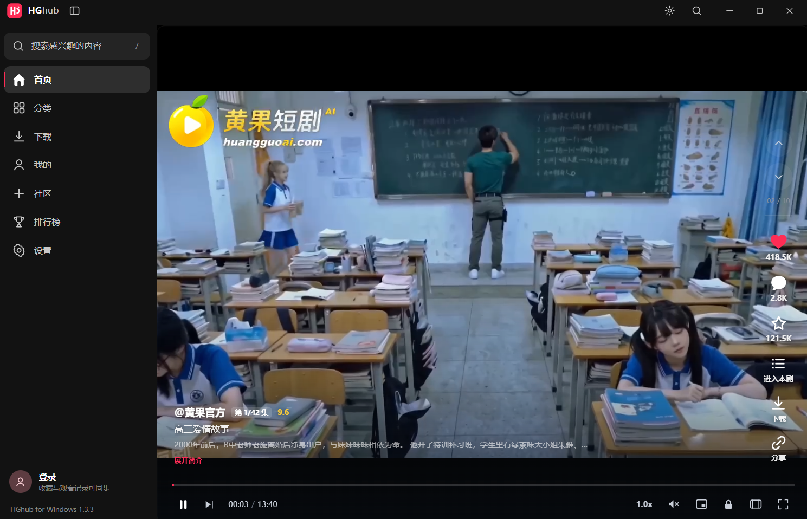
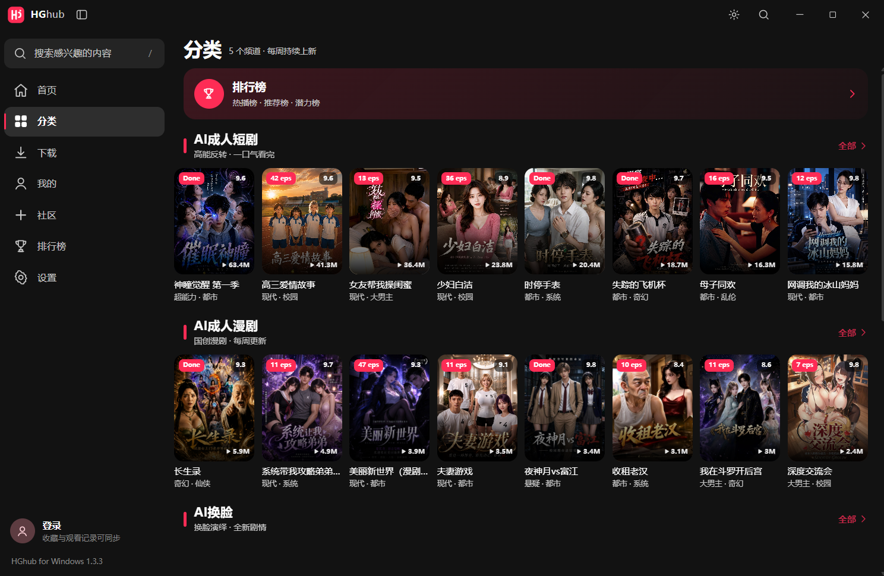

# HGhub

基于 [Minireel/HGhub](https://github.com/Minireel/HGhub) 的 fork：跨平台短剧客户端（Tauri 2 + React）。

仓库：https://github.com/911218sky/HGhub

## 预览

首页竖滑播放：点赞 / 评论 / 收藏、选集、下载与播放控件。



分类浏览：排行榜入口与各频道横滑海报墙。



## 功能

- 首页竖滑 Feed 与上下文播放（选集、seek、音量、剧场 / 全屏）
- 发现（分类 / 频道）、搜索、排行榜
- 离线下载（全选 / 多选单集 / 整剧）、下载 Tab、选集离线播放
- 社区帖子与详情
- 个人中心：收藏、观看历史、登录 / 注册
- 设置：主题、语言、API 线路、安全与缓存

## 技术栈

| 层级 | 技术 |
| --- | --- |
| 壳层 | Tauri 2，Rust ≥ 1.90 |
| UI | React 19，TypeScript，Vite 8，Tailwind CSS 4 |
| 播放 | hls.js |
| 包管理 | pnpm 10，Node ≥ 26 |

## 快速开始

环境：Node.js 26、pnpm 10、Rust 1.90+，以及目标平台的 [Tauri 前置依赖](https://v2.tauri.app/start/prerequisites/)。

```bash
pnpm install --frozen-lockfile
pnpm app:dev
```

安装包见 [Releases](https://github.com/911218sky/HGhub/releases)。

## 许可证

[PolyForm Noncommercial 1.0.0](LICENSE) — 仅限非商业使用。

## 文档

接手维护请先读 [docs/HANDOVER.md](docs/HANDOVER.md)。

| 文档 | 内容 |
| --- | --- |
| [docs/HANDOVER.md](docs/HANDOVER.md) | 首日清单、关键模块、发版 |
| [docs/ARCHITECTURE.md](docs/ARCHITECTURE.md) | 架构与模块 |
| [docs/DEVELOPMENT.md](docs/DEVELOPMENT.md) | 开发环境与测试 |
| [docs/SECURITY.md](docs/SECURITY.md) | 安全模型 |
| [docs/MEDIA.md](docs/MEDIA.md) | 媒体管线 |
