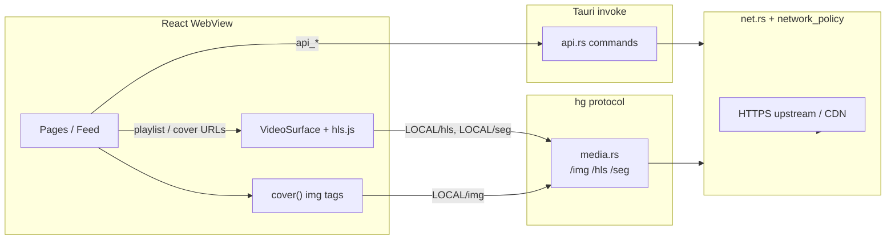

# 架构

HGhub 是 Tauri 2 应用：React WebView 经 `invoke` 调 Rust；加密封面与 HLS 经自定义 `hg` 协议由 Rust 提供，WebView 不直连上游媒体 URL。

## 前端

| 区域 | 路径 | 职责 |
| --- | --- | --- |
| 入口 | `src/main.tsx`、`src/App.tsx` | 启动、Tab 壳、栈浮层 |
| 状态 | `src/store.tsx` | Tab、导航栈、主题、语言、登录态相关 UI、本地点赞/收藏/历史 |
| API 门面 | `src/api.ts` | `invoke` 封装；`LOCAL` / `cover()` / `playlist()` |
| Feed 播放器 | `src/components/Feed.tsx` | 竖滑 / 上下文 Feed、选集、面板 |
| 播放表面 | `src/components/VideoSurface.tsx`、`PlayerControls.tsx`、`PlaybackLock.tsx` | hls.js + 控件 |
| 页面 | `src/pages/{Home,Category,Search,Downloads,Profile,Settings,Posts}.tsx` | Tab 根页与导航栈页面 |
| HTML 消毒 | `src/html.ts` | 帖子正文 DOMPurify |
| i18n | `src/i18n/` | `zh` / `en` 文案目录 |

### Tab 与导航栈

底部 Tab（`src/store.tsx` 中的 `Tab`）：`home` | `category` | `downloads` | `search` | `profile`。

浮层栈（`Page`）：`feed` | `channel` | `ranks` | `settings` | `posts` | `post` | `downloads`。`App.tsx` 在栈下方渲染当前 Tab；`Feed` 既作首页 Tab，也作压栈的 `feed` 页（`mode="home" | "context"`）。

桌面端有 `DesktopChrome` / `ResizeHandles`；移动端使用安全区 inset，以及可选的方向 IPC。

### Feed 播放路径

1. UI 经 `api.feed` / `api.video` / `api.play` 加载卡片 / 详情 / 播放 URL（`src/api.ts` → Rust `src-tauri/src/api.rs` 中的 `api_*`）。
2. 播放 URL 改写为 `${LOCAL}/hls?u=…`（`playlist()`）。
3. `VideoSurface` 用 hls.js 加载该 URL；改写后的 m3u8 将分片/密钥指向 `${LOCAL}/seg?u=…`。
4. 封面使用 `${LOCAL}/img?u=…`（`cover()`）。

`LOCAL` 必须与 Rust `media::LOCAL_ORIGIN` 一致（见下）。

## Rust 后端

| 模块 | 路径 | 职责 |
| --- | --- | --- |
| 应用入口 | `src-tauri/src/lib.rs` | 插件、导航守卫、`hg` 协议、命令注册 |
| 业务 API | `src-tauri/src/api.rs` | Tauri 命令：鉴权、Feed、播放、线路、更新、清缓存 |
| 网络 | `src-tauri/src/net.rs` | reqwest 客户端、线路 base URL、edge POST、代理覆盖 |
| 策略 | `src-tauri/src/network_policy.rs` | 目标 URL 检查、严格模式、FakeIP 白名单 |
| 媒体 | `src-tauri/src/media.rs` | 封面 AES 解密、HLS 改写、IMG/PL/SEG(/KEY) 缓存 |
| 线路 | `src-tauri/src/lines.rs` | 镜像列表 / 探测 |
| 会话 | `src-tauri/src/session.rs` | 绑定到源站的 token（应用数据目录） |
| 播放日志 | `src-tauri/src/playback_log.rs` | 可选诊断环形缓冲 |

命令在 `lib.rs` 注册（`api::*`、`playback_log::*`）。会话与线路状态在启动时绑定到应用数据目录。

## 自定义协议 `LOCAL_ORIGIN`

注册 scheme：`hg`（`lib.rs` → `register_asynchronous_uri_scheme_protocol("hg", …)`）。

| 平台 | Origin 常量 | 前端 `LOCAL`（`src/api.ts`） |
| --- | --- | --- |
| Windows、Android | `http://hg.localhost` | 相同 |
| macOS、iOS、Linux | `hg://localhost` | 相同 |

由 `media::handle` 处理的路由：

| 路径 | 用途 |
| --- | --- |
| `/img?u=` | 拉取密文封面 → AES-128-CBC 解密 → 图片字节 |
| `/hls?u=` | 拉取 m3u8 → 将 key/variant/segment URI 改写到本地 `/seg` |
| `/seg?u=` | 拉取分片或密钥（或嵌套播放列表，再改写） |

严格模式下，若协议请求的 `Origin` 不是允许的前端源，则拒绝。有请求 Origin 时，响应会设置对应 CORS。

## 数据流

播放路径简述：**UI → invoke 播放 URL → 改写为 `LOCAL/hls` → Rust 拉取并改写 m3u8 → hls.js 请求 `LOCAL/seg` → Rust 拉取分片/密钥（可缓存）→ WebView 解码。**
